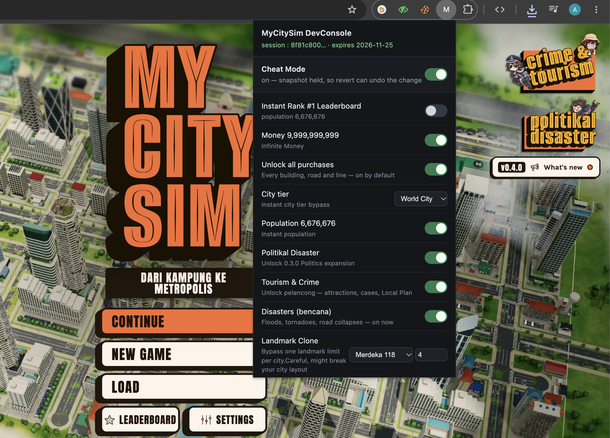

# MYCITY SIM MOD MENU
### Patch : v.0.4.0 [25 November 2026]
### Step 1: Download the Extension

1. Download [mycitysim.zip](./mycitysim.zip) from this repository.
2. Extract the ZIP file to a folder on your computer.

### Step 2: Load the Unpacked Extension

1. Open Google Chrome.
2. Navigate to `chrome://extensions/`.
3. Enable **Developer mode** (top-right corner).
4. Click **Load unpacked**.
5. Select the extracted folder.
6. The extension is now installed and ready to use.

**Note:** Make sure you select the extracted extension folder, not the ZIP file.

---

